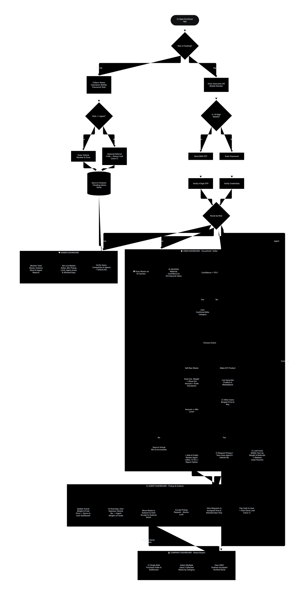

# 🍃 EcoVision — AI-Powered Smart Waste Management & Circular Economy Platform

[](https://github.com/nadeemmhdm/Eco-Vision/actions)
[](https://developer.android.com/)
[](https://kotlinlang.org/)
[](https://developer.android.com/jetpack/compose)
[](https://supabase.com/)

> **"Don't just classify waste. Price it and move it."**  
> EcoVision connects households, doorstep pickup agents, recycling companies, and platform governance into one unified, verified loop.

---

## 📱 Visual Workflow & System Architecture



---

## 🌟 Core Connected Roles

| Role | Interface & Controls |
| :--- | :--- |
| **🛡️ Platform Admin** | Master **Maintenance Mode switchboard**, KYC document verification desk (Aadhaar/GST/CIN), Agent **Vehicle Photo vs License Plate matching**, dynamic **Weight-Tier Pricing Slab engine**, and dispute resolution. |
| **🏠 Households (Sellers)** | **AI Waste Scanner** with YOLOv8 & Google Vision inference, instant DIY upcycle suggestions, **Upcycled P2P Store** with price negotiation (bargain), **Virtual Bin** with minimum pickup threshold rule, doorstep vehicle verification, and **Leaf Coin rewards**. |
| **🚚 Pickup Agents** | Geographic zone (Pincode) & schedule (allowed days) filtering, pickup acceptance with **atomic locking**, doorstep **physical scale spot weighing & price revision**, cash payout, and **Godown Stock Acceptance gate**. |
| **🏭 Buyer Companies** | B2B verified feed (only godown-accepted inventory), **multi-household bulk lot pooling**, single checkout with automated manifests (`EV-MANIFEST-XXXX`), and ESG carbon offset impact calculation. |

---

## ⚡ Key Platform Features & Workflows

### 1. Adaptive 2-Step Sign-In & Security Center
- **Step 1:** Enter Username or 10-digit Indian Mobile (`+91`).
- **Step 2 (Adaptive Route):** Mobile triggers instant 6-digit SMS OTP; Username prompts for password.
- **Step 3 (Optional 2FA):** Support for Google Authenticator (TOTP) and secondary Email OTP verification.
- **Mandatory KYC Onboarding:** Collects Aadhaar/Voter ID (Households), RC book & live Vehicle Photo (Agents), and GSTIN / Udyam registration (Recyclers).
- **Mandatory Legal Consent:** Strict checkbox validation for Terms & Conditions, Privacy Policy, and transparent data usage disclosure.

### 2. AI Waste Scanner & Dual Selling Paths
- **YOLOv8 Computer Vision Simulation:** Categorizes PET plastic bottles, cardboard, aluminum cans, copper wires, e-waste, glass, and mixed non-recyclables with confidence scoring.
- **AI DIY / Upcycle Engine:** Recommends creative crafts (self-watering planters, desk organizers, decorative lanterns) for identified materials.
- **Dual Selling Paths:**
  - **Option A (Upcycled P2P Store):** Craft the waste into a value-added product and list it for sale with real-time peer price negotiation (bargain).
  - **Option B (Raw Waste Virtual Bin):** Input estimated quantity, compute value using weight-tier slabs, and add to bin.
- **Physical Scale Disclaimer:** Prominently notifies users that AI price is an estimate and final payout is governed strictly by the agent's certified physical scale.

### 3. Virtual Bin & Minimum Pickup Threshold
- Enforces an Admin-configured minimum threshold (e.g., minimum **₹100** or **3 kg**).
- **Pickup Request Button is locked** with an interactive visual progress bar until the threshold is satisfied.

### 4. Doorstep Matching & Spot Weighing
- When an agent is assigned, the user dashboard displays the agent's photo, phone number, rating, verified **Vehicle Number**, and **Vehicle Photo**.
- Upon arrival, users physically match the vehicle and driver before handing over waste.
- Agent enters exact physical scale weight, which triggers a **real-time recalculation of final cash payout** via weight-tier slabs.

### 5. Godown Inventory Gate (Critical B2B Safety)
- Agents transport waste to the central godown and click **"Accept to Godown Stock"**.
- Waste is **completely invisible to buyer companies** until godown verification is executed.

### 6. Trust & 12-Hour Exclusive Rating Window
- Once a pickup completes, the Rating & Review window unlocks for **exactly 12 hours**. Only users who had an actual transaction with that agent can submit reviews.
- Users can flag weight tampering or misconduct via the **Report Agent** desk.

### 7. Leaf Coin Gamification
- Users earn Leaf Coins proportional to verified weight recycled (10 coins per kg).
- Referral bonus credits 100 coins to both friends on first verified pickup.
- Redeem coins for **direct UPI cash** or **partner eco-vouchers**.

### 8. Maintenance Mode Switchboard
- Admin can toggle **Platform Maintenance Mode** globally or per role with custom downtime notices and estimated recovery times, while retaining uninterrupted admin access.

---

## 🗄️ Database Schema (Supabase / Postgres)

The backend runs on Supabase (PostgreSQL 17) with the following relational schema:
- `platform_settings`: Maintenance mode status, roles, notice, thresholds, and coin exchange rates.
- `profiles`: Unified user profiles (user, agent, company, admin) with KYC fields and 2FA credentials.
- `agent_details`: Vehicle numbers, photos, assigned pincodes, allowed days, and star ratings.
- `company_details`: Legal company names, GST numbers, and material categories.
- `waste_categories`: Material definitions, base rates, recyclability flags, and DIY suggestions.
- `weight_pricing_slabs`: Dynamic tier-based rates per kg (e.g. 1-5 kg, 5-20 kg, 20+ kg).
- `virtual_bin_items`: Household uncollected waste items with AI confidence metrics.
- `pickup_requests`: Doorstep collection lifecycle states (`requested` ➔ `agent_assigned` ➔ `at_doorstep` ➔ `spot_weighed` ➔ `completed`).
- `godown_inventory`: Warehouse stock items guarded by `pending_acceptance` and `godown_accepted` gates.
- `bulk_orders`: B2B procurement lots with automated manifest identifiers and ESG carbon offset calculations.
- `marketplace_products` & `bargain_offers`: Peer-to-peer upcycled craft listings and interactive bargaining.
- `agent_reviews` & `agent_reports`: 12-hour verified rating window and misconduct reporting.
- `leaf_coin_transactions`: Ledger of rewards, referrals, and redemptions.

---

## 🛠️ Tech Stack

- **UI Framework:** Android Jetpack Compose (Kotlin 2.0.21, Compose Compiler, Material 3)
- **Theme:** Google Stitch inspired modern Dark & Light eco-canvas (`#0A0F1D`, Emerald `#10B981`, Leaf Gold `#F59E0B`)
- **Networking & API:** Ktor CIO Client with Kotlinx Serialization
- **Image Pipeline:** Coil Compose
- **Camera:** Android CameraX (Core, Camera2, Lifecycle, View)
- **Backend / Database:** Supabase PostgREST & Auth
- **CI/CD:** GitHub Actions with automated APK build and release dispatch

---

## 🚀 Building & Running

### Prerequisites
- JDK 21 (Temurin / OpenJDK)
- Android SDK (API Level 35, Build Tools 35.0.0)

### Local Build
```bash
# Clone the repository
git clone https://github.com/nadeem/EcoVision-Android.git
cd EcoVision-Android

# Grant execute permissions
chmod +x gradlew

# Build the Debug APK
./gradlew assembleDebug

# Output APK path:
# app/build/outputs/apk/debug/app-debug.apk
```

### GitHub Actions CI/CD
Every push to `main` or release tag triggers `.github/workflows/android-build.yml`:
1. Sets up JDK 21 and Android SDK.
2. Runs `./gradlew assembleDebug`.
3. Uploads `app-debug.apk` as a build artifact.
4. Publishes a GitHub Release automatically with the release APK attached!

---

## 👥 Team
- **Team Alif:** Abshir · Afra · Nadeem · Yaseen

---

## 📄 License
This project is licensed under the Apache 2.0 License.
