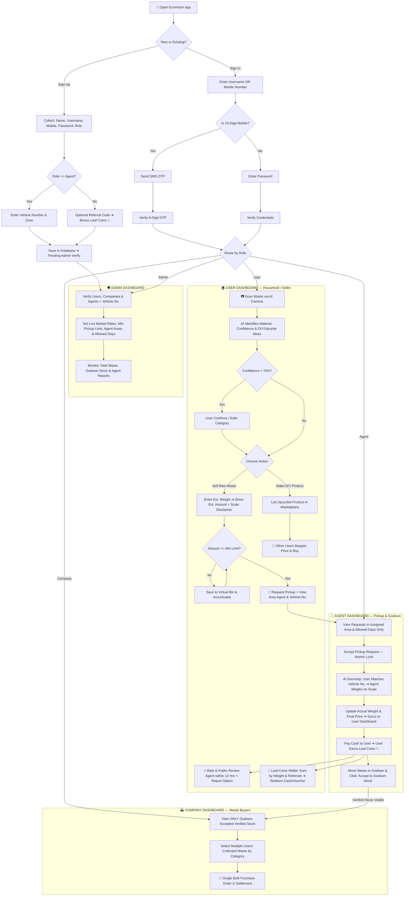

# EcoVision Platform Architecture & Workflow

This document describes the complete end-to-end platform architecture and transaction lifecycle for **EcoVision**.

---

## 🗺️ System Flowchart

---

## 📋 Role Responsibilities

### 1. Platform Admin
- **Governance:** Platform-wide or role-specific Maintenance Mode control with custom downtime notices.
- **Verification Desk:** Review and verify Aadhaar, Business GST, and cross-match Agent Vehicle Photos with registered Vehicle Numbers.
- **Dynamic Pricing Engine:** Set baseline rates and dynamic weight-tier pricing slabs (e.g., 1–5 kg, 5–20 kg, 20+ kg) per recyclable category.

### 2. Households (Users)
- **AI Scanning:** Camera scan using YOLOv8 simulation to classify waste and provide DIY crafts suggestions.
- **Dual Selling Paths:**
  - **P2P Upcycle Store:** List handmade crafts with interactive price bargaining.
  - **Virtual Bin:** Accumulate raw recyclables until minimum threshold (e.g. ₹100 or 3 kg) is reached to request doorstep collection.
- **Doorstep Verification:** Verify agent vehicle number and live photo before handover.
- **Gamified Rewards:** Earn Leaf Coins proportional to kilograms recycled, redeemable for cash or eco-vouchers.

### 3. Pickup Agents
- **Zone & Schedule Filtering:** Agents see only pickups in their assigned geographic pincodes on approved days.
- **Spot Scale Weighing:** Enter certified physical scale weights at the doorstep to compute final cash payout.
- **Godown Inventory Gate:** Collected waste is moved to the warehouse and must be explicitly accepted into godown stock.

### 4. Buyer Companies (Recyclers)
- **Verified Procurement:** Browse godown-verified stock only (unverified or transit waste is hidden).
- **Category Lot Pooling:** Combine multiple users' collected waste into a single bulk purchase order.
- **Automated Manifests & ESG Impact:** Generates transaction manifests (`EV-MANIFEST-XXXX`) and calculates carbon/water savings.
